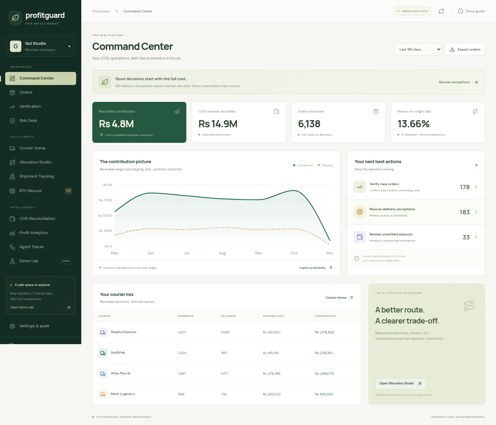

# COD ProfitGuard

An operational, Pakistan-first **synthetic COD SaaS demo**, with a React/TypeScript interface, FastAPI API, persistent SQLite ledger, exact courier assignment, explainable deterministic agents, and all nine executable Demo Lab scenarios.

No paid service, live courier account, store subscription, messaging provider or AI key is required. This is a local demonstration, not a production shipping or payments service. Every customer, merchant, courier, rate and outcome is fictional.

**New to the idea?** Download [the single-page startup overview](startup-overview.html) and open it in a browser. It explains the idea, the software helpers, customers, market-size assumptions, connected delivery choices, value and business model in plain language. The HTML file works offline and can be printed or saved as a PDF.



## Start

Requires Python 3.11+ and Node.js 22.12+ (or Node.js 24+). Clone the repository, then launch the demo:

```bash
git clone https://github.com/Shahoud867/cod-profitguard.git
cd cod-profitguard
python scripts/launch.py
```

The first run installs pinned dependencies and seeds the database. Open **http://localhost:5173**. Choose **Owner** and click **Enter Owner demo**. Stop with Ctrl-C.

Explicit setup/start commands, useful for troubleshooting:

```bash
python scripts/setup.py
python scripts/dev.py
```

Seeded local accounts: `owner`, `manager`, `csr`, `finance`, `viewer`, and `other` at `@profitguard.example`; password **`DemoProfit2026!`**. `other` belongs to the isolated second tenant. The login screen intentionally exposes these local demo credentials. Do not publish this demo with its seeded accounts.

## Explore

- Command Center: order-ledger KPIs, recorded contribution, courier mix, exception queues.
- Orders: CSV preview/import, validation, duplicates, searchable paginated records, evidence drawer and timeline.
- Verification / Risk: synthetic responses, corrections, safe non-response holds, factor explanations and manager release.
- Courier Arena / Allocation: editable fictional rates, eligibility, full-cost comparison, exact assignment, capacity balancing, baselines and approved booking.
- Tracking / Rescue: validated events, duplicate/out-of-order handling, consent-gated retry, RTO and cost recording.
- Finance / Analytics: expected net payout, missing and disputed remittances, statement CSV import, one-paisa reconciliation tolerance, recorded versus pending contribution.
- Agent Traces / Demo Lab: eight real deterministic decision services, nine scenarios, virtual time, persistent jobs and retry simulation.
- Settings: owner policy, tenant memberships, append-only audit, explicit tenant reset. Owner privacy controls are in order details.

Every screen reads the API; browser localStorage is not the database. No workflow sends real messages, books a real courier or moves money.

## Verification

```bash
.venv/bin/pytest services/api/tests -q
cd apps/web
npm test
npm run build
npx playwright install chromium
npm run test:e2e
```

On Windows use `.venv\Scripts\python -m pytest services/api/tests -q`. If an installed Chromium is available, set `PLAYWRIGHT_CHROMIUM_EXECUTABLE` to its executable path instead of downloading one. E2E tests start and stop their own local app; stop an existing dev server first. Browser tests use a disposable isolated database unless you explicitly supply `PROFITGUARD_DB`. Repeat runs leave the working demo untouched.

Other checks:

```bash
.venv/bin/python scripts/validate_seed.py
.venv/bin/python scripts/benchmark.py
```

`validate_seed.py` expects the initial 8,000-order seed, before interactive scenarios. The benchmark uses a disposable 10,000-order database and never changes the working demo.

Read [DEMO_GUIDE.md](DEMO_GUIDE.md), [DEPLOYMENT.md](DEPLOYMENT.md), [IMPLEMENTATION_STATUS.md](IMPLEMENTATION_STATUS.md), [TEST_REPORT.md](TEST_REPORT.md), and [FUTURE_INTEGRATIONS.md](FUTURE_INTEGRATIONS.md).
