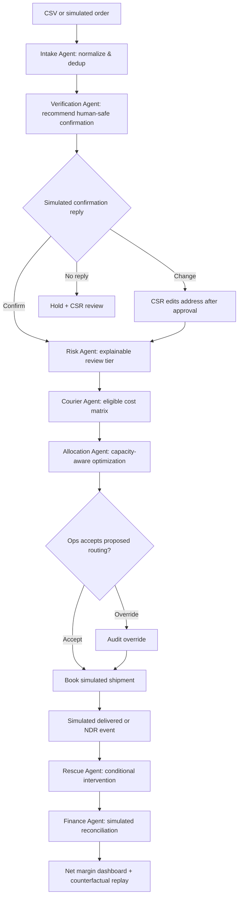

# COD ProfitGuard — Complete Startup & Product Blueprint

**Version:** 1.0 | **Research date:** 2026-11-08 | **Status:** pre-validation concept; no real courier integration or real RTO prediction yet.

## 1. Executive summary, mission and positioning

**One-liner:** a COD profitability decision console for Pakistani online sellers that tells an operator which order to verify, which exception to escalate, which eligible courier to use, and *why*—while tracking actual net costs once shipment outcomes become available.

**Buyer:** owner/operations head of a 100–2,000 COD shipments/month Shopify/WooCommerce/social-selling business; initial hypothesis: Islamabad/Rawalpindi apparel, cosmetics, small household products. **Mission:** prevent avoidable shipping losses while protecting legitimate orders and measuring decisions against actual payout/courier records. **Vision:** accountable multi-courier decision intelligence rather than another generic order dashboard. **North star:** verified **contribution margin per placed COD order**; guardrails: delivered orders, false holds, customer experience, coverage and data privacy.

**Initial sales promise:** show *simulated expected cost consequences* of verification and routing on historical-like records; only claim actual savings after measured field trials. Live courier availability, WhatsApp, delivery predictions, and merchant rate cards require consent/contract and may cost money. A perfect local simulation is not actual courier optimization.

## 2. Evidence-backed market situation

Gallup & Gilani's December 2025 survey reported 60% of recent online shoppers paid by COD [S2]. PwC's 2025 banking summary put cash transactions at roughly 80% of total e-commerce transactions under its methodology and noted more than 9,500 registered merchants with banks by June 2025 [S3]. These figures use different scopes; **do not substitute one for another or assert a universal 80% COD share**. ITA describes Pakistan's cash-heavy e-commerce business environment [S1]. Sector-specific RTO percentages and claimed per-return costs published by vendors are **not independently verified national averages**, so do not use them as market baselines. FBR's August 2025 circular specifies a PKR 200,000 cash limit for COD transaction purposes [S5]; seek professional tax/legal verification for individual merchant flows. The Ministry of Commerce's 2025–30 policy document in [S4] is labeled **draft**, not evidence of current implemented law.

**Merchant workflow hypothesis:** web/store orders arrive, CSR verifies some via call/WhatsApp, ops books courier manually or through an aggregator, status updates arrive at different rates, NDR (non-delivery report) requires exception handling, courier remittance gets reconciled by spreadsheet. Loss comes from shipping unserviceable orders, avoidable RTO, poor cost selection, delayed intervention, and incorrect payout matching. **Evidence gap:** the true allocation of failures between customer refusal, courier performance, address problems, serviceability and product quality must be determined from merchant data.

**Who not to target:** fewer than 50 monthly orders unless margins are unusually high; large stores already locked into comprehensive integrated courier ERP; sellers unwilling to provide anonymized outcomes; merchants seeking guaranteed shipment acceptance; cash transactions beyond appropriate compliance limits.

**TAM/SAM/SOM (planning assumptions, NOT measured market size):** 15,000 potentially qualifying Pakistani COD sellers × PKR 8,000/month × 12 = **PKR 1.44bn hypothetical annual TAM**. Islamabad/Rawalpindi reachable segment assumed 600 sellers × PKR 8,000 ×12 = **PKR 57.6m hypothetical annual SAM**. 12 paying clients by month 24 × PKR 8,000 ×12 = **PKR 1.152m annualized SOM**. Counts are placeholders not inferred from 9,500 registered bank merchants: many social sellers are not registered and not all registered sellers ship significant COD. At 200–1,000 qualifying local merchants and PKR 4k–15k price, SAM sensitivity PKR 9.6m–180m per year. Actual sourcing must sample active merchants, check volume and courier mix, then extrapolate transparently.

## 3. Competitor landscape and differentiation

| Competitor | Publicly advertised capabilities | Price status (snapshot) | What they already solve | Unverified wedge worth testing |
|---|---|---|---|---|
| ConfirmFlow | WhatsApp confirmation, 12+ courier integration, shipment and COD reconciliation [S13] | trial advertised; current full paid rate requires direct check | full workflow breadth | merchant-specific *counterfactual* courier routing and transparent regret analysis |
| ShipUp.app | multi-store ops, 22+ courier claim, RTO, reconciliation, tracking [S14] | demo/quote; not publicly verified | broad courier logistics ERP | usable cost explanation and quality of exception prioritization |
| Kliovo Shop | COD confirms, courier links, AI support [S15] | start free advertised; verify tier terms | sophisticated confirmation + ops claims | independent operational cost audit and local pilot calibration |
| WAB2C | opt-in WhatsApp COD confirmation, yes/no/hold automation [S11] | quote/unverified | pre-dispatch verification | routing optimization with false-hold cost included |
| Order Alert Pakistan | WhatsApp/SMS/robocall order status, confirmation, Urdu templates [S12] | price not verified | automated alerts | compare intervention ROI rather than blanket alerts |
| PakkOrder | automated confirmation, auto-cancellation, multi-channel claims [S16] | free signup advertised; full rate unverified | fake-order filtering | avoid auto-canceling valuable nonresponders; calibrated hold policy |
| Manual sheet + courier portals | manual verification and routing | low software spend, high operator time | flexibility and existing trust | audit/reporting consistency only if proven |

**Caution:** competitor feature claims, provider counts, efficacy statistics, user counts and reliability numbers are *self-reported*. No hands-on product trials or verified user reviews were established here; **customer complaints are not substantiated**. Search and validate frustrations in 10 interviews and with allowed merchant records. **Positioning:** “COD contribution-margin decisions with transparent courier economics,” *not* “Pakistan's first AI COD system.” Differentiation only if replay against a merchant's past orders shows better decisions than that merchant's actual workflow and a strong rules baseline.

## 4. Personas, permissions, complete UI

**Owner:** net profit by cohort and courier; **ops lead:** order review queue, disputes, courier decisions; **CSR:** confirmation and NDR interventions; **finance:** courier remittance/reconciliation; **viewer:** reporting only.

| Page | Actions and visible outputs | Guardrails |
|---|---|---|
| Command Center | placed, confirmed, shipped, delivered, RTO, contribution margin, pending exposure | simulator label and actual/simulated toggle |
| Orders | CSV ingest, validation, duplicates, details, bulk filter, hold/approve | double-confirm on bulk dispatch |
| Verification | pending confirmation queue, simulated message/call, response, operator override | no live send in demo |
| Risk Desk | ranked suspect orders, feature reasons, confidence, alternative action | risk ≠ fraud; cannot automatically accuse customer |
| Courier Arena | compare eligible carriers, price cards, expected delivery/RTO, capacity | do not rank unavailable/unpriced courier |
| Allocation Studio | preview batch matching, capacity/fairness weights, cost and constraints | operator commit required |
| Shipment Timeline | book_simulated, in-transit, NDR, delivered, RTO events, retry | idempotent event transitions |
| Rescue Queue | late/incomplete addresses and NDR intervention suggestions | human decision before customer contact |
| Finance Reconciliation | uploads merchant statements, expected vs actual COD/remittance | material mismatches routed to review |
| Profit Analytics | by city/courier/SKU, expected vs realized contribution, counterfactual replay | uncertainty and confounding display |
| Agent Trace & Simulator | inputs, objective contributions, alternative options, simulated clock | reproducible seed/run ID |
| Settings | zones, rate cards, cap, tenant roles, audit and consent | owner only for policy changes |

**MVP:** CSV orders, city/serviceability normalization, human verification + simulated response, transparent rule-risk tier, courier rate cards and capacity, cost-based routing, shipment state machine, NDR rescue, remittance matching, profit dashboard, optimizer replay, demo lab, RBAC. **V1:** official store webhooks, customer-authorized courier API, status sync, real rate card import, supervised model calibration. **Later:** probabilistic risk models with merchant-specific historical data, cross-merchant privacy-safe benchmarks only with consent, price negotiation analytics, dynamic capacity optimization.

## 5. Feature contracts, lifecycle, and complete scenarios

| Feature | Input / processing | Output and KPI | Failure and ethical control |
|---|---|---|---|
| Import | order ID, line items, amount, city, address quality flags, COD amount, delivery window | accepted/duplicate/rejected rows | missing amounts/invalid cash limits reviewed |
| Verification | permission, contact channel, SLA, response event | confirmed/cancel/request-change/no-response status | absence of reply ≠ fraud; offer human follow-up |
| Risk | historical repeat/failed-delivery signals only when legitimate, serviceability, address completeness, order value | rule tier low/medium/review, reasons | no protected traits, no secret deny list |
| Courier options | merchant-owned rate card by zone/weight, serviceability, COD cap, promised SLA, availability, capacity | eligible choices and expected cost, excluded reason | cost unknown => not optimized; operator fallback |
| Routing | expected forward/return cost, uncertain outcome probability, SLA penalty | proposed courier, alternatives, sensitivity | probabilities simulated and never represented as calibrated |
| Shipment | courier reference mock, time-ordered events | state transition and ETA status | duplicate/out-of-order events to review queue |
| NDR intervention | delivery failure reason/time, customer permission, approved templates | action priority and simulated resolve | never spam; only approved channels |
| Reconciliation | courier billing/remittance files + confirmed expected amounts | discrepancy cases, net margin calculation | mismatched reference → unresolved not automatic payout |

**Order state:** `imported→verification_pending→confirmed→ready_to_ship→booked_simulated→in_transit→out_for_delivery→delivered`; branches: `cancelled_before_ship`, `hold_review`, `NDR→reattempt→delivered`, `NDR→RTO_initiated→returned`, `lost/damaged_dispute`. Guard illegal jumps, audit manual changes; simulated cash settlement separate `unreconciled/reconciled/disputed`.



**Scenario A — expensive RTO prevented (counterfactual only):** order PKR 4,500, transport PKR 280 forward + 180 reverse; customer selects cancel before dispatch in the simulated verification flow. Label **avoided hypothetical shipping exposure PKR 460**, not proven RTO savings (a cancellation might otherwise have delivered). **Scenario B — valid customer falsely held:** unresponsive but legitimate customer; operator overrides hold, shipment delivers; dashboard counts false-hold risk, preventing naive “all nonresponses are fake” narratives. **Scenario C — courier allocation:** 100 orders across Islamabad, Rawalpindi, Lahore, Peshawar, compare eligible costs and capacity 40/35/25, optimize batch, include excluded carrier reasons. **Scenario D — NDR:** address incomplete → simulated call → corrected address → retry → delivery; chronological event log and cost changes. **Scenario E — cash payout:** import manifest 30 shipments and remittance statement with 2 mispriced returns, 1 missing payout; finance opens discrepancy, not auto-resolved.


## 6. Zero-cash technical foundation

### Technology decision record

| Layer | Default | Why | Alternative / tradeoff |
|---|---|---|---|
| UI | React + TypeScript + Vite + Tailwind + Recharts | fast, typed, polished tables/charts | Next.js brings extra runtime complexity |
| API | Python FastAPI + Pydantic + SQLAlchemy | validation, auto OpenAPI, ML/optimization libraries | Django offers more integrated admin |
| Demo database | SQLite WAL, local disk | works fully offline | PostgreSQL for commercial multi-user deployment |
| Auth | seeded demo accounts; Argon2 password hashes, signed HTTP-only session cookie | secure-ish local role demonstration | OIDC later; never ship demo credentials publicly |
| Orchestration | Python explicit state machine + persisted job records | visible, deterministic, testable | LangGraph optional later, not an MVP dependency |
| Analytics | SQL aggregates + Pandas only for offline analysis | cheap, explainable | DuckDB for large local event datasets |
| Optimization | SciPy `linear_sum_assignment` or OR-Tools where constraints require | reproducible, interpretable | Greedy baseline to establish uplift |
| Predictions | calibrated logistic regression / scikit-learn, guarded by rule baseline | trainable on synthetic data but **not validated on real outcomes** | no-ML baseline remains the default |
| Testing | pytest + httpx + Vitest + Playwright | covers API, UI and browser workflows | manual scripts only as additional validation |
| Packaging | Docker Compose optional; native Python + Node fallback | repeatable on laptops | container is not necessary for first demo |
| Hosting | localhost is the guaranteed PKR 0 option | persistence under your control | Cloudflare Pages static frontend; Render free API not suitable for persistent SQLite |

Official limitations: GitHub Free includes private repos and an included Actions allowance [S19]. Cloudflare Pages Free currently documents 500 builds/month and limits [S17]. Render Free sleeps after 15 minutes of inactivity and has ephemeral filesystem, which can delete SQLite state [S18]. None guarantees always-on zero-cost production. WhatsApp API message charges and courier fees are **not** included in local demo [S20]. Standard internet/electricity/laptop costs are outside the no-new-cash assumption.

### Data isolation and safety

- All tenant-owned tables require `tenant_id`; every query is filtered by tenant at repository boundary, not merely UI.
- Unique constraints should be composite: `(tenant_id, external_id)`, `(tenant_id, normalized_phone)` where appropriate.
- User→membership→tenant→role resolution on server; deny by default. Roles: owner/admin, manager, operator/agent, viewer. Audit log immutable to normal users.
- Security headers, same-site HTTP-only cookies, CSRF defense on mutations, CORS allowlist, password rate limiting, upload size caps, row-level permission checks, SQL parameterization, CSV formula-injection sanitization.
- Hash or encrypt sensitive identifiers where possible; avoid actual CNIC collections entirely. Demo contacts use fake +92-style reserved *synthetic* identifiers and `.example` email domains, never real people's contact details.
- Store `consent_source`, `consent_at`, `opt_out_at`, retention policy and deletion/export action for customer records. Human approval required for outbound messaging or destructive decisions.
- Production needs secured backups, key management, monitoring, threat model, data processing terms, and legal review. Pakistan privacy/tax framework should be checked against **current official law** before handling live personal data; do not assume a draft is binding legislation.
- Observability fields on every job: `job_id`, `tenant_id`, `correlation_id`, `created_at`, `status`, `retry_count`, `last_error`; structured JSON logs exclude message bodies/phone numbers by default.

### APIs, errors, and background jobs

- `/api/v1/auth/login`, `/auth/logout`, `/auth/me`; `/tenants/current`; `/audit`; `/settings`; `/demo/reset` (demo admin only).
- Every request supports a `X-Request-ID`; write endpoints use `Idempotency-Key`; pagination uses cursor or stable `(created_at,id)` ordering; timestamps UTC, UI Asia/Karachi.
- `400` invalid format, `401` unauthenticated, `403` unauthorized, `404` cross-tenant opaque not-found, `409` duplicate/conflict, `422` validation, `429` rate limit, `503` external integration unavailable.
- SQLite-safe MVP job runner: `jobs` table + polling process, with leased `locked_until` and retry backoff. **Run a single worker for SQLite**. On production Postgres graduate to a durable queue; avoid blindly relying on in-memory FastAPI background tasks.
- A `connector_adapter` interface supports `simulation`, `csv_file`, `webhook` and later `real_provider`; simulation emits traceable events into the *same* downstream processing logic as real inputs.

### Shared repository scaffold

```text
product/
  README.md  .env.example  docker-compose.yml  Makefile
  apps/web/  src/{pages,components,features,lib}  e2e/
  services/api/  app/{api,auth,db,models,schemas,services,agents,optimization,connectors,jobs}
  services/api/alembic/  services/api/tests/
  scripts/{seed.py,validate_seed.py,run_demo.py}
  data/{fixtures,schemas}/  docs/{architecture,runbooks,privacy,interviews}/
  .github/workflows/test.yml
```

**Local bootstrap (implement these commands in the repository):**

```bash
python -m venv .venv
# macOS/Linux: source .venv/bin/activate   Windows: .venv\Scripts\activate
pip install -r services/api/requirements.txt
cd apps/web && npm ci && cd ../..
python -m alembic -c services/api/alembic.ini upgrade head
python scripts/seed.py --seed 20261108 --reset --scenario all
uvicorn app.main:app --app-dir services/api --reload --port 8000
# separate terminal
cd apps/web && npm run dev
# tests
pytest services/api/tests -q
cd apps/web && npm run test && npx playwright test
```

`requirements.txt` and `package-lock.json` must be committed and versions pinned. If migrations are not yet initialized, Codex must generate them **before** asking user to execute the bootstrap. `.env.example`: `DATABASE_URL=sqlite:///./demo.db`, `DEMO_MODE=true`, `SIMULATED_EXTERNALS=true`, `APP_SECRET=change-me-local-only`, `CORS_ORIGINS=http://localhost:5173`, `SEED=20261108`. Never expose local demo to internet with default credentials.

### Integration ladder

1. **Offline proof:** CSV import/export, click-to-generate simulated inbound events, simulated message/courier status, no third parties.
2. **Customer-assisted pilot:** customer provides sanitized CSV and supervises decisions; manually execute external messages/dispatch in their existing systems.
3. **Official production adapters only:** validate platform permissions, opt-ins, API pricing, webhook signatures, provider contracts and retries before enabling. No unofficial WhatsApp scraping, bulk blasting, or automated browser impersonation.

## 7. UI system and demo quality bar

Design: uncluttered B2B interface, desktop-first with responsive mobile tables/cards. Neutral white/charcoal, one purposeful accent, typography hierarchy, 8px spacing scale, visually clear KPIs, evidence drawer showing each decision's inputs, score, alternatives, owner, and event log. WCAG-conscious keyboard interactions, contrast, focus rings, labels, no color-only status. Loading skeleton, zero-data guidance, API-error recovery, undo for reversible decisions and confirmation dialogs for irreversible actions.

Every page has working navigation and **real database-backed changes**. Charts derive from actual seeded rows; no hard-coded KPI numbers. Include: left navigation, global search, date range filters, role switch in admin test mode, export, activity timeline, settings, demo simulation panel, and visible `SIMULATED DATA` watermark on synthetic accounts/reports. Data reset is explicit and only available to owner.

## 8. Reproducible demo data protocol

- Seed with `random.Random(20261108)` and NumPy `default_rng(20261108)`; stable UUIDv5 from entity namespace + ordinal, not random UUIDv4.
- Distributions are **demo assumptions**, never claimed Pakistan population statistics. Store `is_synthetic=true`, `seed_version`, `simulation_rule_version` on datasets and reports.
- Generate historical events first, apply forward-only state machine, derive current snapshots and KPI aggregates rather than inventing independent totals. Use local PKT working-hours logic and UTC persisted timestamps.
- Use test-only identity strings (`0300-TEST-0001` as display placeholder, not dialable; internal normalized synthetic IDs like `SYN-PK-000001`), obviously fictional business names, `.example` emails. Do not produce plausible real personal numbers for communications.
- Reconciliation assertions: event total equals aggregate; final statuses partition the original count; monetary subtotals reconcile; no foreign-key or tenant leakage; timestamps consistent; every exception has an audit entry; reruns produce identical checksum.
- Seed edge cases: duplicate imports, canceled item, missing address, stale task, conflicting agent suggestion, zero-value record, consent refused, retryable connector failure, non-responders, outlier purchase values, cross-tenant access attempt.

## 9. Product reliability and acceptance gates

| Gate | Acceptance |
|---|---|
| Functional workflow | seed → ingest → decide → human override → event → KPI update without direct DB edits |
| API | OpenAPI schemas, validation errors, auth/RBAC, tenant isolation tested |
| Idempotency | sending same record and key twice creates one business event |
| Privacy | no real outgoing message by default; no actual phone/courier booking in demo |
| Explainability | every recommendation shows feature contributions, alternatives, rule/score version |
| Data integrity | deterministic seed checksum; all dashboards reconcile to source rows |
| Reliability | injected timeout and duplicate webhook handled without data loss |
| Accessibility | keyboard nav, visible focus, labels and adequate contrast |
| Performance | seed 10k records; filter a 1k-row table in under 1s on target laptop after warmup (aspirational, benchmark required) |
| Honest demo | all conversion/savings/accuracy charts marked `Simulated`; baseline and assumptions inspectable |

**Known limitation:** full compliance, model accuracy on live data, continuous uptime, external integration quality, and actual ROI cannot be proven by a synthetic local demo. Establish those only in later controlled pilots.

## 10. Multi-agent and game-theoretic architecture

**Agents with independent responsibilities, shared event log:** Intake parses; Verification suggests contact; Risk scores review tier; Courier quotes and serviceability; Allocator chooses route; Rescue prioritizes NDR; Finance reconciles. These are specialized cooperating decision agents, **not** multiple costly chatbots. Shared facts use tenant-specific DB events; commands are proposals, decision state transitions require typed validation and approval. Conflict resolution: hard constraints first (eligible lane, COD cap, approved courier, capacity), then minimize objective; ties deterministic, alternative shown; operator may override with reason.

**Game/optimization model:** merchants and couriers interact strategically: couriers offer prices, service coverage and capacity; merchants route volume to maximize expected margin; future incentives for reliability can change allocations. MVP does *not* claim a Nash equilibrium without modeling courier strategic responses. For order `i`, courier `j`: expected cost `C_ij = F_ij + pRTO_ij × R_ij + pLate_ij × L_i + H_ij`; `F` forward fee, `R` return/extra failed-delivery cost, `L` late penalty, `H` handling/reconciliation overhead. Maximize `Σ_ij x_ij (expected contribution_i − C_ij)` subject to each confirmed eligible order assigned ≤1 courier; capacity `Σ_i x_ij ≤ cap_j`; serviceable zone, weight limit, COD amount and human hold constraints. Historical failure probabilities are unavailable for initial use: display scenario assumptions; use scenario ranges [low/base/high] and a deterministic baseline until real labels permit calibration.

**Example (hypothetical):** Islamabad parcel with courier A forward 230, return 180, estimated RTO 12% = 251.60; courier B forward 250, return 100, estimated RTO 5% = 255.00. Without further penalties choose A by PKR 3.40, despite B's lower hypothetical RTO. If actual RTO estimates are uncertain, show 5–20% sensitivity and explain route may flip. A false positive hold has expected *lost contribution*; e.g., 10% risk of preventing a legitimate PKR 900 margin sale ⇒ hold penalty PKR 90, preventing agent from labeling every risk as reject. All scores and “probabilities” are simulated until merchant outcome validation.

**Game-theory application beyond matching:** repeated merchant–courier interaction. A transparent service-level score affects future allocation and gives couriers an incentive to meet performance, but merchants must not fabricate service metrics or breach contractual allocation minimums. Bargaining model (future, **not MVP**): choose volume commitment `v` and rate discount `d` to maximize merchant expected gain subject to courier minimum revenue and service guarantees; only with verified contracts. Test optimizer vs cheapest-forward-fee baseline and current merchant allocation; if gain disappears after reverse costs and selection bias, revert to simpler policy.

## 11. Schemas, API, synthetic data, validations

**Relational entities** (every tenant-owned row `tenant_id`, audit timestamps, UUID ID): `tenants`, `users`, `memberships`, `stores(platform,alias,currency)`, `orders(store_id,external_id,placed_at,display_customer_id,city,zone,postal_prefix,address_quality,subtotal_pkr,cod_pkr,weight_g,items_count,verification_status,risk_tier,fulfillment_status,synthetic_flag)`, `order_items(order_id,sku_id,qty,unit_price_pkr,cogs_pkr)`, `skus(sku,category,weight_g)`, `couriers(code,name,active)`, `courier_rate_cards(courier_id,zone,weight_min_g,weight_max_g,forward_fee_pkr,return_fee_pkr,cod_fee_pkr,capacity_per_day,serviceable_from,to_date)`, `verification_attempts(order_id,channel,approved_by,simulated,response,status)`, `risk_assessments(order_id,policy_version,features_json,score,explanation_json)`, `routing_recommendations(order_id,alternatives_json,objective,approved_by,overridden_reason)`, `shipments(order_id,courier_id,booking_ref,tracking_ref,status)`, `tracking_events(shipment_id,event_code,source,occurred_at,ingested_at)`, `ndr_cases(shipment_id,reason,status,resolution)`, `courier_statements(statement_id,booking_ref,net_remitted_pkr,fees_pkr,return_fee_pkr)`, `reconciliation_cases(expected_pkr,actual_pkr,delta_pkr,status)`, `agent_runs`, `audit_events`, `jobs`.

**Constraints:** order status enum; unique `(tenant_id,store_id,external_id)`; nonnegative rates/amounts; no cross-tenant courier rate association; booking refs unique per tenant; explicit `unknown` for missing tracking states. Monetary amounts stored integer paisa or decimal with exact arithmetic (example schema uses `_pkr` as decimal; **do not use binary float**).

**Endpoints:** `POST /orders/import?dry_run=true`, `GET /orders`, `GET /orders/{id}`, `POST /orders/{id}/verification/simulate`, `POST /orders/{id}/verification/record`, `POST /orders/{id}/risk`, `POST /couriers/rate-cards/import`, `POST /routing/preview`, `POST /routing/commit`, `POST /shipments/{id}/tracking-events`, `POST /shipments/{id}/ndr`, `POST /reconciliation/import`, `GET /analytics/rto`, `GET /analytics/margins`, `GET /analytics/courier-comparison`, `POST /replay/run`, `POST /demo/scenarios/{key}/run`, `POST /demo/reset`. Every mutation audited, idempotent and role-checked.

**Dataset PG-1:** 2 tenants, 3 fictional brands, 4 fictional *rate-card* couriers clearly marked simulated, 12 fictional SKUs, 8,000 orders / 180 days, 8,000 verification results, ~6,500 shipment histories (rest canceled/held), 35,000 tracking events, ~1,000 NDR cases, 8,000 line items minimum, 300 payout rows, 30 intentional billing discrepancies, 100 duplicates, 100 partial addresses, 50 missing delivery results. Cities Islamabad 25%, Rawalpindi 22%, Lahore 18%, Karachi 15%, Faisalabad 8%, Peshawar 7%, others 5% (assumption); COD order values lognormal clipped PKR 700–25,000; rate cards forward PKR 160–550, reverse PKR 100–350; outcomes generated by location, address completeness and courier scenario latent rule to enable optimization demonstration. The synthetic *underlying outcome model must never be described as real learned Pakistan courier quality*. Seed 20261108, persistent version and checksum.

**Reconciliation:** `gross collected COD − expected courier fees − adjustments = expected remittance`; separate sales revenue, COGS, packaging, shipping, return cost, COD fee, marketing spend and refunds. For each placed order: realized `contribution = received_customer_payment − product_COGS − net_outbound_shipping − return_shipping − packaging − variable_customer_service − variable_marketing − refunds/discounts` (handle COGS differently for returned/restocked inventory; do not double count returned stock). Pending shipments show **estimated**, not realized margin. Failed delivery with returned unsold inventory is not equivalent to cost of goods permanently lost.

**Tests:** importing same order twice idempotent; COD > PKR 200k triggers policy-review warning not silent approval; unreachable zone has no selected courier; allocation never exceeds caps; missing return fee marks estimate incomplete; 10 out-of-order tracking events sorted by occurred_at but original ingestion preserved; NDR retry doesn't invent customer approval; reconciliation exact decimal with 1 paisa tolerance policy; order held for review never booked; all synthetic scenario counts and financial sums match displayed charts; tenant cross-access blocked; no real message/booking emitted from demo.

## 12. Implementation milestones + agent prompt

| Phase | Work | Required outcome |
|---|---|---|
| 0 | scaffold, auth, data model, seed 8k orders | migrations + fixed checksum |
| 1 | CSV importer, orders list/detail, rate cards | import with errors and dedup |
| 2 | verification simulator and state machine | confirm/hold/cancel works end to end |
| 3 | risk evidence and courier cost matrix | each proposal explains inputs/alternatives |
| 4 | matching optimization, approval, booking simulation | no infeasible allocation; override logged |
| 5 | NDR tracking, reconciliation, margins | expected vs actual exact arithmetic |
| 6 | charts, scenario lab, replay, browser tests | all five scenarios executable |
| 7 | customer data discovery and manual pilot | safe baseline and signed authorization |

**Codex Master Implementation Prompt:**

> Read `COD_ProfitGuard_Complete_Startup_Blueprint.md` entirely as the authoritative requirements. Implement a polished, **fully functioning** local React/TypeScript + FastAPI + SQLite COD decision console using 8,000 reproducible Pakistan-specific synthetic orders and mock courier rates. First implement import→verify→review→courier compare→batch optimize→human approve→simulate shipment/NDR→reconcile→real DB analytics, then other screens. Build deterministic MAS modules and constrained optimization; expose exact cost factors, uncertainty, safeguards, trace and audit. Implement tenant-safe RBAC, Pydantic schemas, migration files, unit/integration/browser tests, genuine event-driven KPI calculations and documented one-command demo setup. Never send live WhatsApp/SMS, book actual couriers, scrape websites, use paid keys, assume real courier rates, or claim synthetic model predictions are validated. Show tests and unresolved issues after each implementation phase; no placeholders or dead buttons.

## 13. Financial model, price hypotheses and validation of ROI

**Pricing to test, not asserted WTP:** Basic PKR 4,999/month (500 orders, CSV/manual workflow); Operations PKR 9,999/month (2,500 orders, routing recommendations); Scale PKR 19,999/month (more orders, reconciliation, future integrations). Usage beyond tier and live provider charges separate. Avoid fee models requiring a cut of “savings” estimated only from simulation; if performance pricing, pay only against auditable agreement and verified baseline.

**Illustrative ROI:** 1,000 COD orders/month; assumed 20% baseline RTO; intervention hypothetically reduces *actual* RTO to 17%, i.e. 30 fewer returns × PKR 450 avoidable net return-related costs = PKR 13,500 monthly direct cost reduction. After PKR 9,999 subscription, PKR 3,501 before intervention messaging/call labor, lost revenue from false holds, product margin changes and provider fees. Crucially, RTO rate can fall merely by canceling orders before shipping, so assess **contribution per placed order** and delivered-order count, not RTO alone. Estimate using matched / randomized shipping cohorts and record avoidable costs with carrier invoices.

**Secondary hypothetical routing saving:** 600 eligible shipments × PKR 20 verified average total-cost improvement = PKR 12,000/month, *only* if equal service quality and real contract rates. Do not add to confirmation savings without checking overlap/double counting.

| Month-12 case | Customers | Avg monthly fee | MRR | Required condition |
|---|---:|---:|---:|---|
| Conservative | 1 | 5,000 | 5,000 | no verified performance yet |
| Base | 6 | 10,000 | 60,000 | several integrations/CSV operations reliable |
| Optimistic | 18 | 12,000 | 216,000 | evidence-backed ROI and referrals |

**Operating economics illustration:** client PKR 9,999/month, incremental cloud/support/message-adapter expenses PKR 2,500 (hypothetical) ⇒ PKR 7,499 contribution, 75%. With PKR 45,000/month fixed costs, ~7 clients for fixed-cost coverage (founder salaries/tax excluded). Real logistics charges are customer expenses and should not automatically be counted as your SaaS COGS, unless the contract makes you financially responsible. CAC: founder outreach hours + travel + data mapping + integration time; no credible numeric CAC without pilot tracking. Future funding may be needed for provider integration, compliance, customer support and cash runway.

## 14. Customer discovery, marketing and first revenue

**Prospects to verify:** active clothing/cosmetics/household Shopify and WooCommerce sellers based in Islamabad/Rawalpindi; find via publicly available storefronts, Instagram shop links, business directories and voluntary referrals. Do **not** imply a specific store is a paying prospect until confirmed. Qualify monthly volume, courier mix, historical return log and owner access first. 20 contacts → 10 interviews → aim for 3 data-sharing discussions → 2 pilot-ready merchants (targets, not conversion-rate predictions).

**12 discovery questions:** orders/month; percentage COD; all courier contracts and weight/zone rates; recorded RTO by courier/city; true return cost; fraction canceled pre-ship; causes of NDR; data export availability; same-store seasonal shifts; payout discrepancies; current manual labor hours; budget authority and willingness to pay for audited per-order savings.

**WhatsApp manual intro:** “Assalam-o-Alaikum. I’m researching how local online brands verify COD orders and reconcile courier charges. I built a small *simulation* showing the cost of return scenarios and how courier selection could change. Could I ask 10 minutes about your actual process? No store login is needed.”

**Email:** Subject `Question about COD delivery and courier costs at [store]` — “Hello, I’m prototyping a COD operations tool that compares verification, routing and real return-cost assumptions. It currently uses synthetic examples rather than promised savings. Would you be open to a short discussion about your shipment workflow and whether a supervised CSV-based pilot could measure any benefit?”

**Visit:** request owner/ops manager, show saved examples on laptop, never ask for full customer list onsite; offer NDA and anonymized sample. **Seven-minute demo:** 0:00 cost problem; 1:00 import 10 fictional orders; 2:00 customer verifies/cancels in local simulator; 3:00 route 5 eligible orders with cost alternatives; 4:00 inject NDR; 5:00 resolve and import payout discrepancy; 6:00 show margin chart and assumptions; 7:00 ask for their actual courier fee sheet and shipment outcome export.

**Objections:** “We already use ConfirmFlow/ShipUp” → ask whether *verified cost-aware decisions* are missing; “prediction inaccurate” → baseline rule and uncertainty, no trained-live claim; “our couriers have private prices” → secure tenant-specific CSV rate card; “WhatsApp costs” → local prototype no messages and per-template production budget; “automation may cancel good orders” → default review, never auto-cancel; “can you guarantee saving?” → no, test a matched cohort.

**Pilot contract idea:** demo free using fake data; 30-day supervised paid pilot hypothesis PKR 3,000–8,000, subject to meaningful measurable impact and legal handling. Required field test: owner authorizes data, define control and treatment by city/order type, log actual shipment outcome and return cost, log false holds, reconcile courier payouts, check contribution per placed order. Long-term expansion via WooCommerce implementers and fulfillment consultants only after data accuracy proven.

## 15. Seven days and 90 days

**Day-by-day first week (~2–3h/day, plus available interviews):**

| Day | Action | Evidence / deliverable |
|---|---|---|
| 1 | identify 12 shops and conduct 4 volume/return interviews | sources and reasons for failed orders |
| 2 | review ConfirmFlow, ShipUp, Kliovo features and 4 more interviews | evidence of unmet cost decision |
| 3 | implement schema, 8k-seed, order upload and validation | repeatable data ingestion |
| 4 | verification local workflow + risk explanations | tested hold/release/cancel |
| 5 | courier rate matrix and batch optimizer | feasible matches and cost display |
| 6 | synthetic NDR/reconciliation + dashboard; 2 seller demos | demo flow + cost objections |
| 7 | ask for 2 anonymized rate/outcome files and pilot commitment | go/pivot/stop decision |

**90-day weekly roadmap (8–12h/week student-founder assumption):**

| Week | Milestone | Outcome / gate |
|---|---|---|
| 1 | 8 interviews + seed/import | problem and flow exist |
| 2 | 4 more interviews + competitor demo trials | 12 interviews and true gap assessment |
| 3 | verification and order states | no invalid dispatch |
| 4 | rate cards and optimization | 100-order stress case |
| 5 | NDR tracking + intervention rules | chronological replay works |
| 6 | reconciliation + true margin model | totals match expected ledger |
| 7 | UX, errors, RTO charts | 5 scenarios pass |
| 8 | data controls and security | tenant, consent, replay tests |
| 9 | 5 demos to qualified shops | 2 written data/pilot intents |
| 10 | negotiate pilot and collect deidentified rates | permitted baseline |
| 11 | controlled supervised evaluation | intervention and control outcomes tracked |
| 12 | audit cost, false holds, support time | estimated ROI or inconclusive result |
| 13 | priced pilot renewal / pivot | first paid customer **target**, not guarantee |

**Continue** if ≥2 qualifying merchants share rate/outcome data and at least one requests a paid trial; **pivot** to reconciliation-only if integrated competitors already automate verification, but payout errors remain high; **stop** if real outcomes are inaccessible or merchants will not pay. Prioritize a single high-value feature, not 22 courier APIs at once.

## 16. Risk matrix and validation gates

| Risk | Severity | Control / next experiment |
|---|---|---|
| Saturated verification/ERP vendors | high | test audited cost decision instead of checkbox features |
| Unavailable courier APIs and rate cards | critical | user-supplied CSV, simulation, manual pilot |
| RTO selection bias | critical | optimize margin per **placed** order; false-hold tracking |
| Incorrect probability estimates | high | ranges, calibrated models only after labels, no hard denial |
| Consent, unsolicited WhatsApp | high | only opted-in official channels; human supervision [S20] |
| Customer PII leaks | critical | isolate/encrypt, pseudonymize, delete on request |
| Shipment or payout inconsistencies | high | ledger reconciliation, exception queue, immutable raw source |
| Courier contract constraints | medium | capacity, zones, exclusivity and SLA as hard constraints |
| Fraud mislabeling | high | label as `needs_review`, not `fraudster`; allow appeal |
| Legal/tax constraints | high | check FBR COD rule [S5] and current applicable laws before live ops |
| Production infra costs | high | precise paid-cost budget; no SQLite on ephemeral hosted disk [S18] |

**Unvalidated assumptions:** typical RTO rates and unit return costs, willingness to pay, available merchant export quality, whether courier choice predicts outcome, availability of individual customer opt-in, true capacity limits, scale of payout errors, and superiority vs existing integrated platforms. No performance or sales claim is verified at this stage.


## 17. Direct comparison and startup recommendation

Scoring is **founder judgement, not measured market evidence**. A 1–5 score is worse-to-better; for risk, 5 means *lower risk*. Weights sum to 100. Weighted result is sum(weight × score/5), out of 100.

| Criterion | Weight | LeadPilot | ProfitGuard | Basis for subjective comparison |
|---|---:|---:|---:|---|
| Speed to first paying customer | 14 | 4 | 3 | LeadPilot manual CSV workflow can sell before integrations |
| Access to decision-makers | 12 | 4 | 3 | Local service-business owner/operator access hypothesized easier |
| Urgency of problem | 12 | 3 | 5 | COD shipping loss can be priced per failed order |
| Willingness to pay | 9 | 3 | 4 | ProfitGuard has clearer cost-savings calculation |
| Student MVP feasibility | 11 | 5 | 4 | Fewer data dependencies for LeadPilot |
| Zero-cash demo feasibility | 10 | 5 | 5 | Both can run offline with simulated connectors |
| Differentiation vs incumbents | 7 | 2 | 2 | Both competitive; gaps must be validated |
| Authentic MAS/game-theory value | 8 | 4 | 5 | Both have constrained allocation; courier choices add strategic complexity |
| Long-term revenue upside | 7 | 4 | 4 | Both scalable if integrations and retention work |
| Scalability and defensibility | 5 | 3 | 3 | Integration, data, workflow depth required |
| Technical/commercial risk | 5 | 4 | 2 | Courier data integration and legal consent create extra risk |
| **Total /100** | **100** | **76.2** | **75.0** | **Illustrative, sensitivity-test below** |

**Score arithmetic:** LeadPilot `(14×4 + 12×4 + 12×3 + 9×3 + 11×5 + 10×5 + 7×2 + 8×4 + 7×4 + 5×3 + 5×4)/5 = 76.2`; ProfitGuard `(14×3 + 12×3 + 12×5 + 9×4 + 11×4 + 10×5 + 7×2 + 8×5 + 7×4 + 5×3 + 5×2)/5 = 75.0`. **Totals are 76.2 and 75.0 out of 100**, respectively.

- **Fastest feasible first revenue and best student-founder choice:** LeadPilot, conditional on interviews demonstrating a quantifiable lead-loss problem.
- **Strongest transactional ROI narrative:** ProfitGuard, if sellers provide usable shipment outcomes and true courier cost structures.
- **Long-term scale:** No empirically justified winner; ProfitGuard may build a more distinctive courier-outcomes data asset, while LeadPilot can serve more industries.
- **Overall recommendation:** validate both for **7 days**, then build **one** functioning vertical slice. Prioritize LeadPilot if at least three decision-makers agree to a time-boxed pilot; switch to ProfitGuard if two COD merchants share historical shipment-level cost/outcome data and commit to a pilot.
- **Evidence gate:** minimum 10 interviews per idea; 3 written requests for a demo; 2 qualified pilot candidates; verified customer workflow; baseline KPI access; responsible-person commitment; a price tested with buyer (not only hypothetical interest). Do not interpret verbal enthusiasm as payment.
- **Sensitivity:** if ProfitGuard's validated willingness-to-pay and pilot-ready access scores increase by one each, its score rises 4.2 points to **79.2**, overtaking LeadPilot. This is why direct discovery should dominate this desk-research ranking.


## 18. Source register and evidence limitations

Research snapshot: **8 November 2026**. Vendor descriptions and prices are **publicly advertised claims**, not independently audited product tests. Source links are included to make subsequent due diligence possible. Zero-cost means no **mandatory cash expenditure** for local development and demonstration on already-owned equipment; it does not mean founder time, power, connectivity, or eventual commercial operations have no economic cost.

- [S1] US International Trade Administration, *Pakistan – eCommerce*, published March 2026: https://www.trade.gov/country-commercial-guides/pakistan-ecommerce
- [S2] Gallup & Gilani Pakistan, COD payment survey, December 19, 2025: https://gallup.com.pk/post/39500
- [S3] PwC Pakistan, *Banking Forward 2025* e-commerce overview: https://www.pwc.com.pk/en/Banking_Publication/folder-2025/PDFs/Summary-of-Key-Insights.pdf
- [S4] Pakistan Ministry of Commerce, **draft** e-Commerce Policy 2025–30 (not enacted policy): https://www.commerce.gov.pk/wp-content/uploads/2025/06/draft-e-Commerce-Policy-2025-30-for-stakeholders.pdf
- [S5] FBR Circular No. 02 of 2025–26 concerning the PKR 200,000 COD cash-transaction limit: https://download1.fbr.gov.pk/Docs/2025813148592598CircularNo.02-2025.pdf
- [S6] HubSpot official CRM pricing: https://www.hubspot.com/pricing/crm
- [S7] Zoho CRM edition limits: https://help.zoho.com/portal/en/kb/crm/crm-reference/introduction-to-zoho-crm/articles/specifications-zoho-crm
- [S8] Kommo CRM pricing: https://www.kommo.com/buy/tariff/
- [S9] FOXAF CRM pricing (vendor-claimed): https://foxaf.com/pricing
- [S10] respond.io pricing: https://respond.io/pricing
- [S11] WAB2C COD verification: https://wab2c.com/solutions/cod-verification
- [S12] Order Alert Pakistan: https://orderalert.pk/
- [S13] ConfirmFlow: https://confirmflow.pk/
- [S14] ShipUp.app: https://shipup.app/
- [S15] Kliovo Shop: https://kliovo.com/shop
- [S16] PakkOrder: https://pakkorder.com/
- [S17] Cloudflare Pages free-plan limits: https://developers.cloudflare.com/pages/platform/limits/
- [S18] Render free-service restrictions: https://render.com/docs/free
- [S19] GitHub included usage: https://docs.github.com/en/billing/reference/product-usage-included
- [S20] Meta/WhatsApp pricing documentation overview (third-party reproduction; recheck directly with Meta before launch): https://www.gupshup.ai/resources/historical-meta-pricing/
- [S21] Kommo plan region caveats: https://support.kommo.com/docs/kommo-subscription-plans-overview
- [S22] FOXAF COD discussion (vendor content, not independent effect-size evidence): https://foxaf.com/blog/whatsapp-rto-reduction-pakistan
- [S23] 2026 OICCI digital report: https://www.oicci.org/app/media/2026/04/OICCI-DIGITAL-REPORT-2025-FINAL.pdf

**Evidence rules:** national e-commerce *revenue* is not SaaS TAM; e-commerce *payment-method surveys* are not merchant RTO measurements; registered bank merchants are not all addressable shops; vendor efficacy figures are marketing unless verified independently. Inconsistent market-wide COD shares arise from different definitions, sampling frames, and periods. All local market segment counts, local prospect availability, willingness to pay, prices for our product, unit-economics inputs, baseline conversion/RTO rates, and agent accuracy estimates below are **explicit hypotheses**, not sourced measurements. No customer interviews, field observations, paid pilots, or competitor hands-on trials have been performed in this research.
